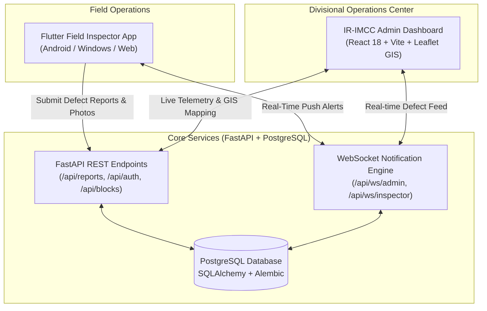

# RailSetu (रेल सेतु) 🚆

> **Intelligent Railway Maintenance Planning & Operations Control Platform**  
> Streamlining track defect triage, cross-departmental coordination, and traffic block authorization for Indian Railways.

---

## 🌟 Overview

**RailSetu** is an end-to-end railway infrastructure safety and operations management system designed for Indian Railways. It connects field maintenance inspectors directly with Divisional Operations Control Centers, bridging the gap between defect identification and block authorization.

The platform consists of three core components:
1. **FastAPI Backend (`backend/`)**: High-performance REST & WebSocket asynchronous service powered by PostgreSQL and SQLAlchemy.
2. **Admin Operations Control Center (`Admin/`)**: Industrial-grade control room dashboard built with React 18, TypeScript, Tailwind CSS, and Leaflet GIS maps.
3. **Field Inspection App (`flutter_field_app/`)**: Cross-platform mobile/desktop client for track inspectors to record geolocated defects, telemetry, and photos.

---

## 🏗️ System Architecture



---

## 📂 Repository Structure

```text
RailSetu/
├── .github/workflows/    # CI/CD automated test and build workflows
├── Admin/                # Operations Control Room Dashboard (React + Vite)
│   ├── src/              # Dashboard components, pages, GIS maps, hooks
│   ├── Dockerfile        # Container build definition for Web UI
│   └── nginx.conf        # Production reverse proxy config
├── backend/              # FastAPI Asynchronous REST API
│   ├── alembic/          # Database migrations
│   ├── app/              # API routes, models, schemas, and services
│   ├── uploads/          # Geolocated defect photographic evidence
│   └── Dockerfile        # Container build definition for Backend
├── flutter_field_app/    # Field Inspector Client (Flutter)
│   ├── lib/              # UI widgets, screens, repositories, state
│   └── pubspec.yaml      # Flutter dependencies and assets
├── docker-compose.yml    # Single-command local deployment orchestration
└── README.md             # Project documentation
```

---

## 🚀 Quick Start Guide

### Prerequisites
- **Python**: 3.10+
- **Node.js**: 20+
- **PostgreSQL**: 14+ (or Docker)
- **Flutter SDK**: (Optional, for mobile app)

---

### Option A: Run with Docker Compose (Recommended)

Run all services (Database, Backend, Admin UI) with a single command:

```bash
docker-compose up --build
```

- **Admin Web Dashboard**: [http://localhost:5173](http://localhost:5173)
- **Backend API**: [http://localhost:8000](http://localhost:8000)
- **Interactive Swagger Docs**: [http://localhost:8000/docs](http://localhost:8000/docs)

---

### Option B: Local Development Setup

#### 1. Start the Backend API

```bash
cd backend

# Create and activate virtual environment
python -m venv .venv
# Windows:
.venv\Scripts\activate
# Linux/macOS:
# source .venv/bin/activate

# Install dependencies
pip install -r requirements.txt

# Run migrations
alembic upgrade head

# Start development server
python -m uvicorn app.main:app --host 0.0.0.0 --port 8000 --reload
```

#### 2. Start the Admin Web Dashboard

```bash
cd Admin

# Install packages
npm install

# Start Vite dev server
npm run dev
```

Visit [http://localhost:5173](http://localhost:5173) to access the control room.

#### 3. Start the Field App (Optional)

```bash
cd flutter_field_app

# Fetch dependencies
flutter pub get

# Run on Chrome or Windows
flutter run -d chrome
```

---

## 🛡️ Key Features

- **Operational Overview**: Real-time fleet and corridor KPIs, active blocks, and GIS map with fly-to zoom.
- **AI-Powered Defect Triage**: Visual defect reports with auto-classified severity (CRITICAL, HIGH, MEDIUM, LOW) and supervisor override capabilities.
- **Smart Opportunity Detection**: Aggregates overlapping maintenance needs across Track (P-Way), Signal (S&T), and Overhead Equipment (OHE).
- **Traffic Block Optimization**: Computes optimal possession windows to minimize passenger and freight traffic disruption.
- **Real-Time WebSockets**: Instant updates push directly across field inspector devices and control room workstations.

---

## 🧪 Testing & CI

Continuous Integration is pre-configured via GitHub Actions:
- **Backend**: Automated pytest suite running on Python 3.11.
- **Frontend**: Automated TypeScript type-checking and Vite production build.

```bash
# Run backend tests locally:
cd backend
pytest -v

# Run frontend typecheck locally:
cd Admin
npm run typecheck
```

---

## 📜 License

This project is developed for hackathon and demonstration purposes. All rights reserved.
